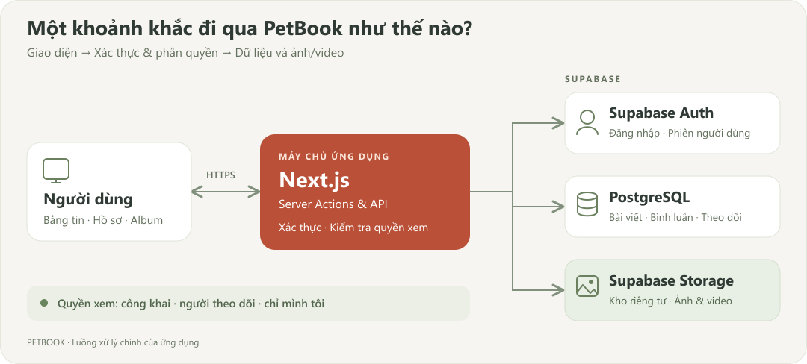

# PetBook 🐾

Mạng xã hội cho thú cưng: chia sẻ khoảnh khắc, kết bạn và lưu giữ kỷ niệm.

**Next.js 15 · React 19 · TypeScript · Tailwind CSS · Supabase**

## Tính năng

- Hồ sơ nhiều thú cưng, bảng tin, ảnh/video và album riêng từng boss.
- Theo dõi, cảm xúc, bình luận, tìm kiếm và thông báo.
- Ba quyền xem bài viết; kỷ niệm năm trước, nhắc sinh nhật và khôi phục mật khẩu.

## Nguyên lý hoạt động



Next.js kiểm tra danh tính và quyền sở hữu trước khi ghi dữ liệu. Ảnh/video mới nằm trong kho riêng tư; quyền xem được kiểm tra trước khi trả nội dung.

## Chạy local

Yêu cầu **Node.js 22+** và một dự án Supabase.

1. Chạy `npm ci`.
2. Sao chép [.env.example](.env.example) thành `.env.local`, điền bốn biến môi trường.
3. Khởi tạo dữ liệu và chạy ứng dụng:

```sh
npm run migrate
npm run dev
```

Mở **http://localhost:3000**. Trên PowerShell, dùng `npm.cmd` nếu `npm.ps1` bị chặn.

Trong Supabase Auth, đặt Site URL và cho phép `<site-url>/auth/callback` trong Redirect URLs để xác nhận email/đặt lại mật khẩu.

## Kiểm tra

```sh
npm test
npm run typecheck
npm run build
```

GitHub Actions tự chạy kiểm thử và build khi push hoặc mở pull request. Kiểm thử database: `npm run test:database` — dữ liệu thử được rollback.

## Lưu ý

- Không đưa `.env.local`, mật khẩu hoặc ảnh/dữ liệu cá nhân lên GitHub.
- Ảnh đại diện và ảnh bìa được hiển thị công khai.
- Đổi mật khẩu database từng nằm trong mã cũ; chuyển ảnh cũ có URL công khai sang kho riêng nếu cần bảo vệ quyền xem.
